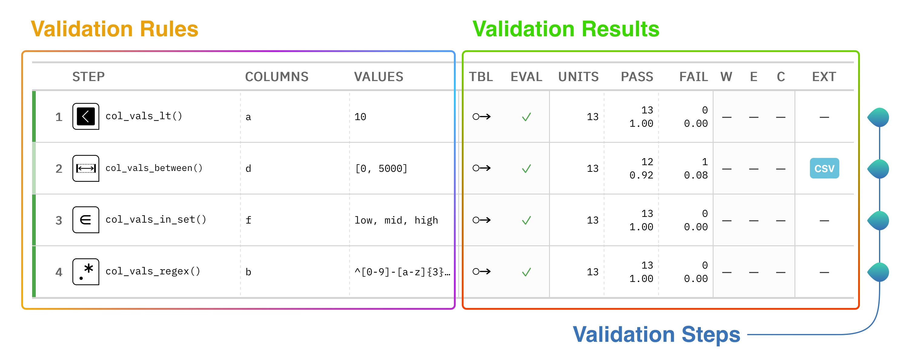
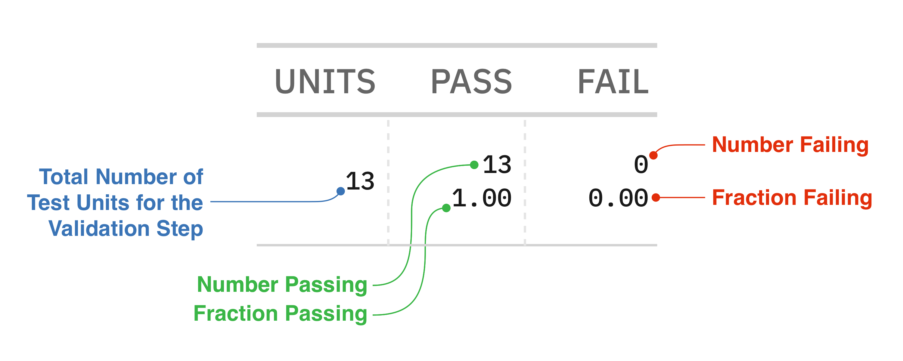

```{python}
#| echo: false
#| output: false
import pointblank as pb
pb.config(report_incl_footer_timings=False)
```

Pointblank checks that a table's data is what you think it is. You write the rules (each one a
*validation step*), Pointblank checks the table against them, and you get a report of what passed
and what failed. The table can be a Polars or pandas DataFrame, a CSV or Parquet file, or a table in
a database. This page goes through the basics in a few minutes and then points to the rest of what
Pointblank can do.

## Installation

Pointblank works with the DataFrame library or database you already use. The examples here use
Polars, so install Pointblank with it:

```bash
pip install "pointblank[pl]"
```

Use `pointblank[pd]` for pandas instead. The [Installation](installation.qmd) page covers databases
and the optional features.

## A First Validation

A validation starts with `Validate`, which takes the table. Each validation method adds a step, and
`~~pointblank.Validate.interrogate()` runs them all against the table:

```{python}
import pointblank as pb

(
    pb.Validate(data=pb.load_dataset(dataset="small_table"), label="Example Validation")
    .col_vals_lt(columns="a", value=10)
    .col_vals_between(columns="d", left=0, right=5000)
    .col_vals_in_set(columns="f", set=["low", "mid", "high"])
    .col_vals_regex(columns="b", pattern=r"^[0-9]-[a-z]{3}-[0-9]{3}$")
    .interrogate()
)
```

The result is a validation report, with a row for each step. The left side of the report has the
rules of each step and the right side has the results:

{width=100%}

- **validation steps**: each step is a separate check of one aspect of the table
- **validation rules**: the type of the step, the column it checks, and its key values
- **validation results**: how many test units were checked, passed, and failed, the threshold
  levels reached, and more

The second step found a value of `d` above 5000. The **CSV** button in its row downloads the failing
row, so whoever reads the report can see exactly what went wrong.

## Understanding Test Units

Each step counts its results in *test units*. A step like `~~pointblank.Validate.col_vals_lt()`
tests every value of a column, so each value is a test unit. A step that checks the whole table,
like `~~pointblank.Validate.col_exists()`, has a single test unit. The `UNITS`, `PASS`, and `FAIL`
columns of the report show the counts, and the `PASS` and `FAIL` columns show the fractions too:

{width=100%}

## Setting Thresholds

A single failing value often isn't a problem, but a lot of them is. *Thresholds* set how many
failing test units are acceptable before a step is flagged at one of three levels: 'warning',
'error', and 'critical'. Thresholds can be set for the whole validation (and changed for any step
with its own `thresholds=`). The tuple `(1, 0.1)` sets the 'warning' level at 1 failing test unit
and the 'error' level at 10% of them:

```{python}
validation = (
    pb.Validate(
        data=pb.load_dataset(dataset="small_table"),
        label="Thresholds for the whole validation",
        thresholds=(1, 0.1),
    )
    .col_vals_lt(columns="a", value=7)
    .col_vals_between(columns="d", left=0, right=5000)
    .col_vals_not_null(columns="c")
    .interrogate()
)

validation
```

The `W`, `E`, and `C` columns show the levels. Every step reached the 'warning' level (a filled gray
circle). Steps 1 and 3 also reached the 'error' level (a filled yellow circle), since more than 10%
of their test units failed, while step 2 didn't (an open circle). No 'critical' level was set, so
that column has a dash. The [Thresholds](../validation-plan/thresholds.qmd) page has more ways of
setting them.

## Taking Action

*Actions* respond when a step reaches a threshold level. An action can be a message or a function
(e.g., one that posts to Slack). A message can use placeholders like `{step}`, `{type}`, and `{col}`
to say which step it's about:

```{python}
(
    pb.Validate(
        data=pb.load_dataset(dataset="small_table"),
        thresholds=(1, 0.1),
        actions=pb.Actions(error="{LEVEL}: step {step} ({type}) failed on column '{col}'."),
    )
    .col_vals_lt(columns="a", value=7)
    .col_vals_between(columns="d", left=0, right=5000)
    .col_vals_not_null(columns="c")
    .interrogate()
)
```

The message was printed for the two steps that reached the 'error' level. The
[Actions](../validation-plan/actions.qmd) page covers functions as actions, and actions that run
once at the end of a validation.

## Using the Results

The report is for people to read, but the results are available in code too, so a script, a
pipeline, or a test can act on them. `~~pointblank.Validate.all_passed()` says whether every test
unit passed:

```{python}
validation.all_passed()
```

To stop a pipeline or fail a test, `~~pointblank.Validate.assert_passing()` and
`~~pointblank.Validate.assert_below_threshold()` raise an `AssertionError` (see
[Assertions](../advanced-validation/assertions.qmd)). To see the failing rows of a step, use
`~~pointblank.Validate.get_step_report()` for a report or `~~pointblank.Validate.get_data_extracts()`
for a DataFrame:

```{python}
validation.get_data_extracts(i=2, frame=True)
```

And `~~pointblank.Validate.get_sundered_data()` splits the table into the rows that passed every
step and the rows that didn't (see [Sundering Validated Data](../post-interrogation/sundering.qmd)).

## Checking Many Columns at Once

A step can check several columns, given as a list or with a column selector like `pb.starts_with()`.
Each column gets its own step:

```{python}
(
    pb.Validate(data=pb.load_dataset(dataset="small_table"))
    .col_vals_not_null(columns=pb.starts_with("d"))
    .col_vals_gt(columns=["a", "d"], value=0)
    .interrogate()
)
```

The [Column Selection Patterns](../validation-plan/column-selection-patterns.qmd) page has the other
selectors and how to combine them.

## Other Kinds of Tables

`Validate(data=)` takes more than DataFrames. A file path, a glob of Parquet files, or a database
connection string works too:

```python
pb.Validate(data="sales.csv")
pb.Validate(data="data/orders/*.parquet")
pb.Validate(data="duckdb:///warehouse.ddb::orders")
```

A connection string needs the extra for its database (e.g., `pointblank[duckdb]`, see
[Installation](installation.qmd)), and the table is checked in the database rather than read into
memory.

## What Else Pointblank Can Do

The rest of the **User Guide** goes further. Here's where to look for some common tasks:

| To... | See |
|-------|-----|
| explore a new table before writing rules | [Previewing Data](../data-inspection/preview.qmd), [Column Summaries](../data-inspection/col-summary-tbl.qmd), [Missing Values](../data-inspection/missing-vals-tbl.qmd) |
| have an LLM draft a validation plan from your data | [Draft Validation](../advanced-validation/draft-validation.qmd) |
| check the columns and types of a table | [Schema Validation](../advanced-validation/schema-validation.qmd) |
| check groups of rows separately, or transform the table first | [Segmentation](../validation-plan/segmentation.qmd), [Preprocessing](../validation-plan/preprocessing.qmd) |
| write rules as expressions across several columns | [Expression-Based Validation](../advanced-validation/expressions.qmd) |
| score data quality by dimension (completeness, validity, ...) | [Quality Dimensions and Scoring](../post-interrogation/quality-dimensions-and-scoring.qmd) |
| write validations in YAML, or run them from the command line | [YAML Validation Workflows](../yaml/yaml-validation-workflows.qmd), [The Pointblank CLI](../the-pointblank-cli/cli-data-validation.qmd) |
| agree on what valid data looks like, and check it at both ends of a pipeline | [Contracts](../contracts-and-pipelines/contracts.qmd), [Pipelines](../contracts-and-pipelines/pipelines.qmd) |
| compare two tables, or two versions of one | [Comparing Tables](../table-comparison/comparing-tables.qmd) |
| generate realistic test data | [Generating Test Data](../test-data-generation/generating-test-data.qmd) |
| check text and training data for models and LLMs | [Text Checks](../advanced-validation/text-checks.qmd), [Scored Validation](../advanced-validation/scored-validation.qmd), [RAG Checks](../advanced-validation/rag-checks.qmd) |
| check dataset splits and synthetic data | [Checking Splits](../table-comparison/checking-splits.qmd), [Checking Synthetic Data](../table-comparison/checking-synthetic-data.qmd) |
| measure what each validation step is worth to a model, and document the dataset | [Data Ablation](../post-interrogation/data-ablation.qmd), [Data Cards](../post-interrogation/data-cards.qmd) |
| build validations from metadata, or check clinical (CDISC) data | [Metadata Import](../metadata-import/metadata-import.qmd), [CDISC Validation](../metadata-import/cdisc-validation.qmd) |
| send results to a monitoring system, or use Pointblank from an AI assistant | [OpenTelemetry](../integrations/otel-integration.qmd), [MCP Server](../integrations/mcp-quick-start.qmd) |

To keep going from here, the [Overview](../validation-plan/validation-overview.qmd) of the
*Validation Plan* section surveys the validation methods and the options that they share, and
[Validation Reports](../post-interrogation/validation-reports.qmd) shows how to customize the
report.
